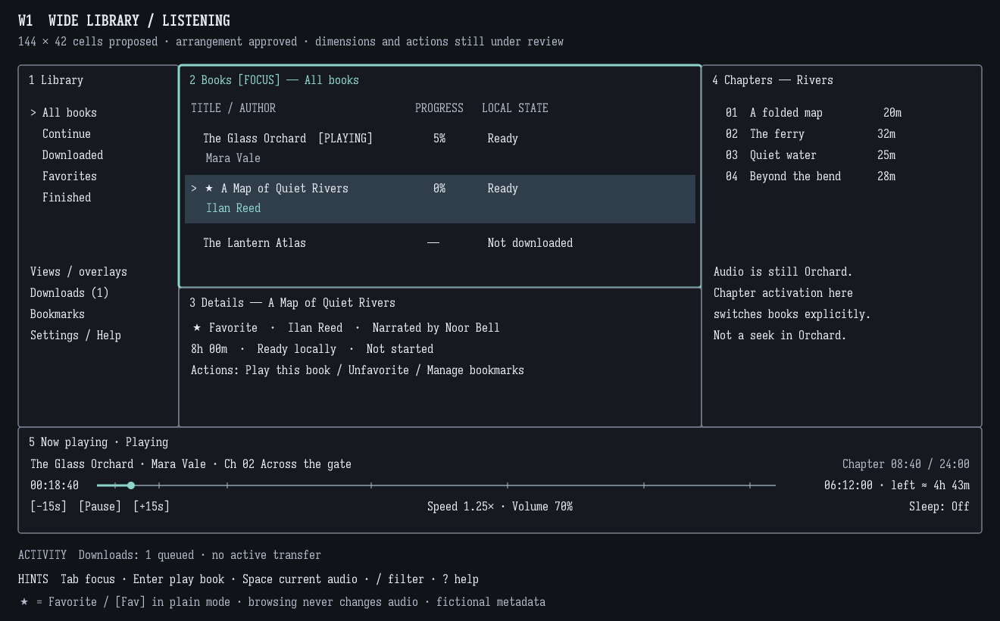
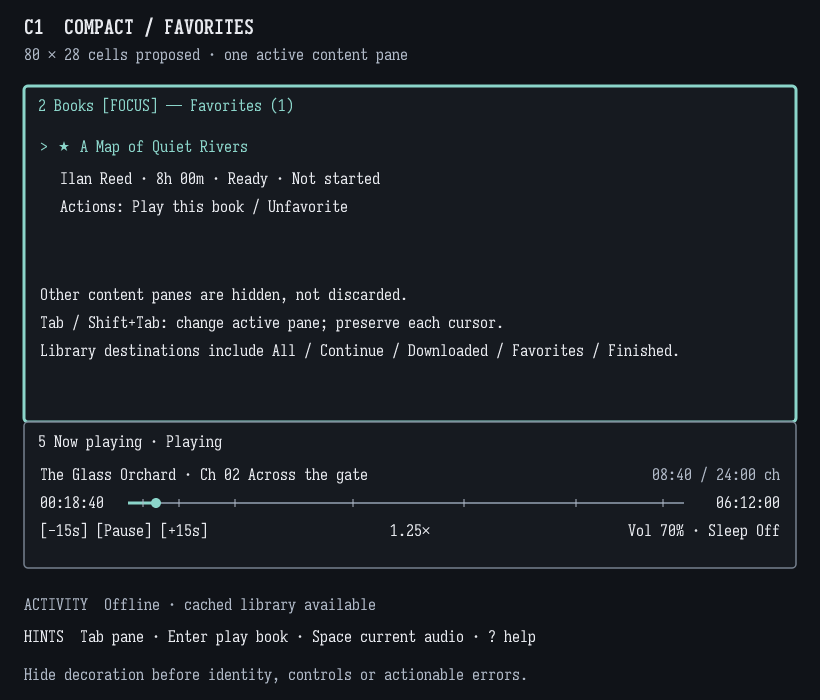
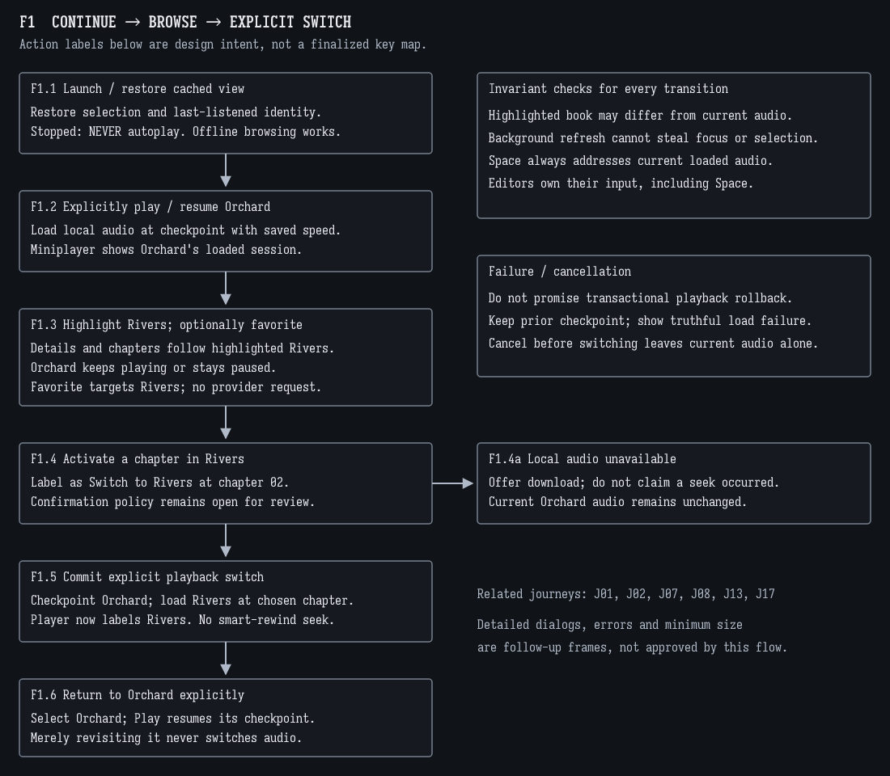

# First-review wireframes — #2

**Approved:** wide/compact arrangement direction, podmutt-style width-filling player,
Details/Chapters following the highlighted book, Iosevka Slab recommendation, MIT and
the `colors`/Omarchy palette direction. **Not yet approved:** exact dimensions/breakpoints, minimum-size
layout, full key map, dialogs and detailed feature states. This PR does not close
#2 or unblock production UI implementation.

These are editable, self-contained **SVG wireframes** with exported PNG previews,
not screenshots of a working application. Open them directly in a browser or SVG editor; their text and shapes
are the source, so no hosted drawing account, build step or generated-image service
is required. All metadata is fictional. The dark palette is illustrative only;
implementation uses [semantic themes](theming.md), not these literal colors.

## W1 — Wide library/listening

[Open editable W1](w1-wide.svg)

- Candidate terminal: **144 columns × 42 rows**. Sidebar 24 columns, middle 78,
  chapters 42, including each region's borders; shared-edge accounting belongs in
  implementation geometry. These are review candidates, not inherited breakpoints.
- Top content: 34 rows. Middle stacks Books (22) above Details (12). Player: 6
  rows, then one activity/error row and one contextual-hints row. Borders/padding
  are included, not extra rows. SVG pixels illustrate hierarchy, not a cell-width
  correctness proof.
- Focus is **2 Books**, identified by `[FOCUS]` as well as an accent border. The
  selected row has a `>` marker and highlight. Star has plain equivalent `[Fav]`.
- **Rivers** is highlighted; **Orchard** is playing. Details and Chapters follow the
  highlighted book automatically and retain that target while focus moves into them.
  Show book titles, not technical Selected/Inspected badges. No separate Inspect
  action. A chapter cursor does not change the highlighted library book.
- Library views: All, Continue Listening, Downloaded, Favorites and Finished.
  Downloads, Bookmarks and Settings/Help open dedicated views/overlays, not new
  permanent columns. The download count is a download queue, never a listening queue.
- `Enter` in Books plays/resumes that book; `Space` addresses loaded audio, unless
  an editor owns input. Highlighting a book updates its details/chapters, never audio.
  Late replies for an older highlighted book cannot replace the new book's content.
- Favorite action targets the highlighted book, also named in Details. It never
  falls back to current audio. Stars do not replace progress or local-download state.
- Now Playing uses its full inner width, following podmutt: book/author/chapter left,
  chapter timing right; then elapsed book time, a stretching book slider with chapter
  ticks, and duration/speed-adjusted remaining time. Controls sit left below, speed
  and volume centrally, sleep status right. The bar shows book progress (~5%), not
  the chapter's ~36%; chapter timing is explicitly labeled. No decorative spectrum.

## C1 — Compact active content above player

[Open editable C1](c1-compact.svg)

- Candidate: **80 × 28**. Active content: 21 rows; player: 5; activity: 1; hints: 1.
  Candidate wide entry threshold is 144 columns **and** 42 rows; other usable
  sizes use compact mode. Validate intermediate widths/heights before approval.
- Keep one active content pane, with its title, filter/view and focus visible.
  Tab/Shift+Tab and numbered focus move to other panes; they do not discard state.
  Avoid a second independent navigation model just for narrow terminals.
- Preserve focus identity, highlighted book and its chapter target, scroll origin and editor
  input when resizing. Resizing never starts/stops audio or abandons a modal.
- Player uses the same width-filling book slider between elapsed and duration stamps.
  Identity/chapter sits above it; transport left, speed center and volume/sleep right
  below it. Omit author/adjusted remaining time before hiding identity or transport.
  Activity and hints remain separate rows.
- The SVG intentionally shows a cached offline Favorites view. Toggling a local
  favorite needs no provider call. An empty Favorites view offers a way back to
  All rather than looking like login or download failure.
- **80 × 20** is a minimum-size candidate for the next review, not an approved
  promise. Below the eventual minimum, show a readable resize/quit message; keep
  audio state intact and preserve modal input. Do not clip silently.

## F1 — Continue, browse, explicitly switch

[Open editable F1](f1-main-flow.svg)

| Step | Input intent | Required state / observation |
|---|---|---|
| F1.1 | Launch, including offline | Restore view/selection, never autoplay; no old-app discovery |
| F1.2 | Play/resume Orchard explicitly | Current audio becomes Orchard at saved position/speed |
| F1.3 | Highlight Rivers; favorite it | Details/chapters follow Rivers; Orchard audio remains unchanged |
| F1.4 | Activate Rivers chapter | Explicitly label cross-book switch; confirmation policy still open |
| F1.4a | No completed local audio | Offer download; never seek Orchard or falsely report success |
| F1.5 | Commit switch | Preserve Orchard checkpoint; load Rivers at chapter, no smart rewind |
| F1.6 | Return to Orchard and explicitly play | Resume its checkpoint; merely highlighting it does not switch |

A failed load must be truthful, preserve the prior checkpoint and expose recovery.
Do not promise the old process/audio can always be transactionally restored after
a real player failure. Cancel before committing a switch leaves current audio alone.

## Review questions / next design slice

1. Accept or adjust 144 × 42 wide and 80 × 28 compact examples? Validate a separate
   minimum-size frame before freezing breakpoints.
2. Follow-selection is now approved: Details/Chapters follow the highlighted book
   without changing audio. Validate rapid selection/late replies and focus transitions.
3. Cross-book chapter/bookmark activation: confirm, or use a clearly labeled explicit
   switch action? Do not silently apply a seek to unrelated current audio.
4. Assign favorite, speed, download, sort, account and Settings actions without
   colliding with existing navigation, bookmark or editor keys. No favorite key is
   approved here. `b` captures the current loaded session, including paused audio;
   `B` manager targeting remains to settle, not inferred from a favorite action.
5. Next frames: download stages/error/recovery; bookmark capture/editor/list/jump;
   paused/empty/error player; favorite save failure and final-row removal; onboarding,
   Settings/theme source, help, small terminal and modal focus restoration.

Full key ownership follows the [interaction contract](../interaction-contract.md).
Do not allow letters, Space or numeric pane shortcuts to escape an active editor.
Final approval requires the remaining #2 acceptance items, not just these sketches.

## Typography / preview export

Use the recommended [Iosevka Slab terminal profile](typography.md) for a bookish
monospace appearance; the application never changes terminal fonts. PNGs were
exported using optional local `resvg-py 0.5.0` with Iosevka Slab v34.9.1 regular/bold
explicitly supplied (this environment's system-font discovery is incomplete).
Font files were downloaded for local preview only, not bundled in this repository.
SVGs request Iosevka Slab with a monospace fallback; PNGs preserve the actual preview.
This is not an application/CI dependency. Edit the SVG sources, then export each
at its declared viewBox size using an SVG renderer with an available monospace font.
Review the PNGs after text or geometry changes; never accept an empty-text render.
CairoSVG could not run here because native libcairo is absent; resvg exports were
used instead. Native terminal-cell tests still belong to implementation.

## Test handoff (requirements, not implemented tests)

| Journeys | Design assertions to carry into implementation |
|---|---|
| J01/J02 | No startup autoplay; cached views and local audio work offline |
| J03 | Keep selected BookID through filter/sort/refresh, including Favorites |
| J04–J06 | Follow-up frames must distinguish transfer/preparation/errors; no fake Ready |
| J07/J08 | Highlighting updates details/chapters, never audio; stale replies ignored; explicit switch checkpoints; pause-aware seeks |
| J09/J10 | Follow-up editor and sleep frames must retain input/target and show current timer |
| J11/J12 | Completion/deleting audio does not remove favorites, bookmarks or history |
| J13 | Every pane fits terminal-cell bounds; player visible; resize/back restores focus |
| J17 (#42) | Favorite Rivers while Orchard plays; restart offline; unfavorite final visible row safely |

J17 is a newly planned journey for #42, not existing executable coverage. Unicode,
CJK/combining widths, long or absent metadata, terminal escapes, unknown durations,
no chapters and plain-text mode must be tested at actual terminal-cell boundaries.
The SVG cannot establish those properties. Runtime coverage for this design slice
is **N/A**; implementation keeps independent ≥95% coverage and full journey gates.
