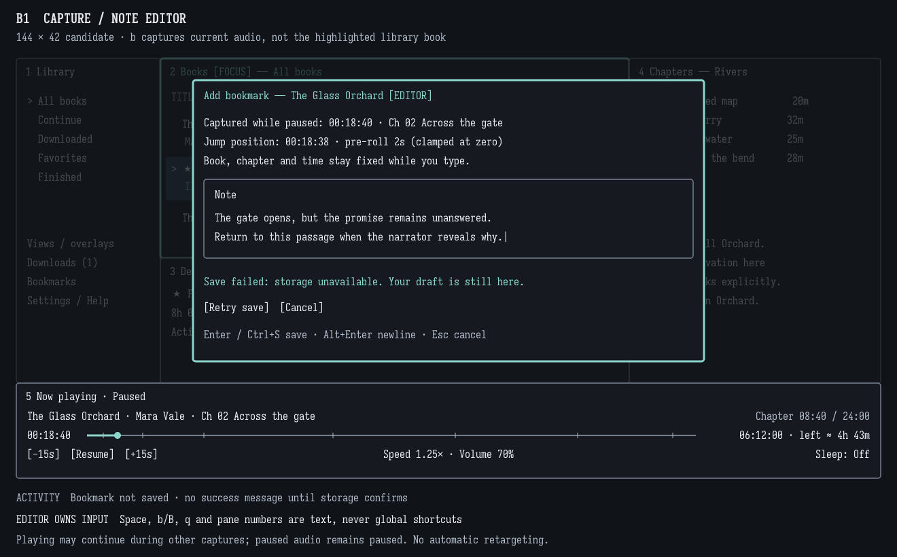
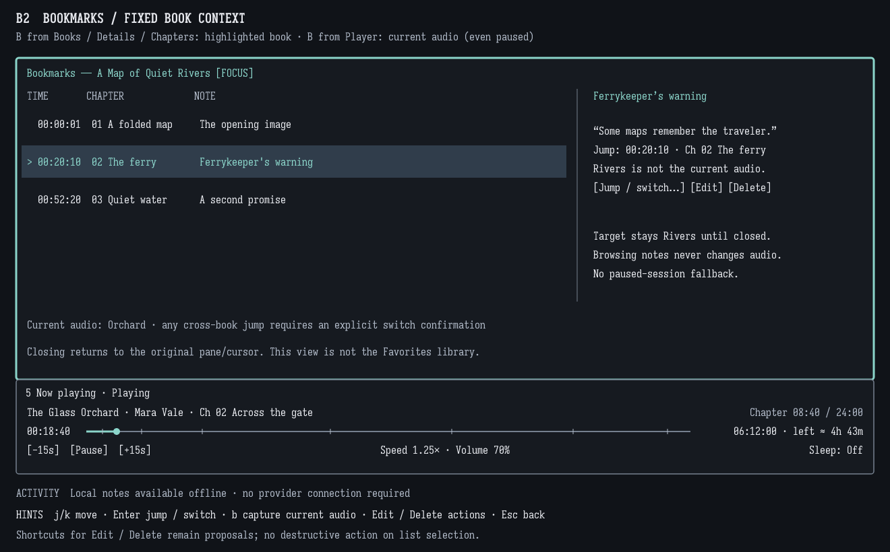
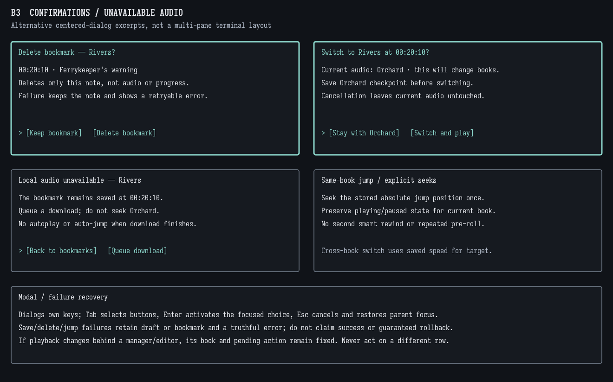

# Bookmarks design — B1 / B2 / B3

Status: **direction accepted via merged PR #45** under #2; remaining geometry and
bindings are consolidated in the [final review](final-review.md). Service #18 and UI #19 remain
blocked by their implementation dependencies; this is not executable bookmark
coverage. Reuse the approved full-width player, [Iosevka Slab](typography.md) and
modal precedence. Fictional books/notes only. Favorites are a separate library flag.

## B1 — Capture now, type later (including paused audio)

[Editable B1 SVG](b1-bookmark-editor.svg)

Lowercase **`b` always captures the loaded current-audio session**, including paused
playback, unless an editor/dialog owns input. In B1, Rivers is highlighted but the
new note belongs to Orchard. No loaded audio means a readable unavailable action,
not a fallback to the highlighted book or its last-known position.

At the action boundary freeze BookID, absolute position, chapter context and the
configured pre-roll. The editor names that book and shows the captured and resulting
jump positions. B1 captures 00:18:40 with two-second pre-roll: stored jump position
**00:18:38**. Compute `max(0, captured - pre_roll)` once. Store that absolute jump
position with note/context/timestamps; the raw capture shown in the editor need not
require a new durable schema field. Later jumps do not subtract pre-roll again.
Neither delayed save, changed speed/config nor new playback can retarget the draft.
If pre-roll crosses a chapter boundary, distinguish captured context from the jump
chapter accurately; absolute jump position is authoritative, not a chapter label.

- Enter/Ctrl+S saves; Alt+Enter inserts newline; Esc cancels to the exact origin.
  Whitespace-only notes are rejected with focus/input retained, not silently saved.
- While the text field is active, Space, b/B, q, numbers and navigation letters are
  input. No playback, pane, favorite or quit shortcuts leak through. Buttons own
  their local keys when focused. Resize/playback updates cannot steal editor focus.
- Opening an editor does not pause playing audio or resume paused audio. B1 is the
  paused case; the same frozen capture applies if audio continues during typing.
- Save failure retains the draft and fixed target with Retry save. Show Saving
  while pending; suppress duplicate submissions. Success is shown only after durable
  confirmation. Do not promise cancel can roll back a write that already committed;
  reconcile late results without creating a second note or touching a different book.
- Edit uses the same editor but changes only text on the fixed bookmark identity;
  it does not recapture the current position or reapply pre-roll. Cancel leaves the
  original note untouched. Closing a nested editor returns to its parent manager.

## B2 — A manager with an explicit, stable book target

[Editable B2 SVG](b2-bookmark-manager.svg)

**`B` targeting rule:** choose once from the visible originating context,
show the book in the manager header, and keep it fixed until that manager closes.

| Origin | Manager target |
|---|---|
| Library Books, Details or Chapters | Highlighted library book (the same title named in Details/Chapters) |
| Focused Now Playing pane | Loaded current-audio book, playing **or paused** |
| Library sidebar Bookmarks entry | Highlighted library book; name it in the action/label before activation |
| No valid book in that context | Disabled/unavailable with guidance; no fallback to another book |
| Other supporting views | Use an explicit named-book action or return to Library/Player; no inferred target |
| Existing manager/editor/dialog | Parent owns keys; B never silently retargets it |

This is context-based, **not** a paused-versus-playing heuristic. Background refresh,
new library selection or changed current audio cannot retarget an open manager.
While Details/Chapters follow the highlighted book in normal browsing, a bookmark
manager/editor holds its explicitly named target for its lifetime.

List in stored jump-position order, with stable bookmark identity for equal times;
show chapter context and note preview. The selected note's full multiline text uses
the remaining content area and scrolls when needed. Empty state explains that `b`
captures current audio; no fake chapter/position is created when playback is absent.
Missing chapter metadata keeps the absolute time visible with an honest unavailable
chapter label. Render notes as plain text with safe multiline handling, never execute
pasted ANSI/control sequences. A capture from a manager for another book still names
**current audio** in its new
editor; after save/cancel return to the unchanged manager, not the captured book.

Enter requests a jump (or the labeled cross-book switch dialog). Edit/Delete are
explicit row actions, not consequences of navigation. Keep target IDs fixed while
an action menu is open; if its bookmark disappears, invalidate the action instead
of operating on the next row. Failed load/query keeps the target header and a retry
message, not a misleading empty list. Offline local notes need no provider call.

On the read-only list, Space/comma/period retain current-audio transport; the focused
note scroller owns its navigation. Menus, editors and confirmations own all keys.
Esc unwinds child → manager → original pane, with selection/focus restored; local
filter edit/clear follows the shared interaction contract before navigating back.
The [final-review key map](keys.md) assigns x for row actions; Edit/Delete have no
hidden destructive letter aliases.

## B3 — Delete, jump and missing local audio

[Editable B3 SVG](b3-bookmark-actions.svg)

These are alternative **centered-dialog excerpts**, not a four-pane terminal layout.
Actual dialogs retain the player where geometry permits; compact/minimum-size
geometry follows the bounded [R1 final review](final-review.md). B1/B2 use 144 × 42.

- **Delete:** name book/time/note and default to Keep bookmark. Confirm deletes only
  that bookmark. Cancel changes nothing; failure retains recoverable context and
  reloads authoritative data as needed. Keep selection valid after deleting the
  last visible row. Never delete audio, favorites or history through this action.
- **Same loaded book:** jump to the stored absolute position, preserving playing or
  paused state; no second pre-roll or smart rewind. Stale/out-of-range media context
  must yield a truthful seek result/error rather than a success applied elsewhere.
- **Different book:** use a confirmation for **both bookmarks and chapters**:
  name target book/time and current audio, initially focus Stay. Explicit **Switch
  and play** checkpoints the old book, loads local target audio at the chosen position
  with its saved/default speed and starts playing. This explicit button also explains
  why cross-book activation from a paused session starts audio. Checkpoint failure
  blocks the switch; cancel beforehand leaves current audio unchanged.
- **Missing local audio:** keep the bookmark, offer Queue download and remain in the
  manager. Never seek unrelated current audio. Download completion does not autoplay
  or schedule a surprise jump; the user activates the bookmark again when Ready.
- **Failure/race:** preserve bookmark and checkpoint, show actionable sanitized
  errors, never promise transactional restoration of a failed player process. If
  current audio changes behind an open switch dialog, invalidate/reconfirm its
  displayed source before executing; do not silently switch away from new audio.
  Tab chooses buttons, Enter activates the focused choice, Esc cancels.

## Implementation test handoff — design is not executable coverage

| Journey | Required assertions |
|---|---|
| J09 | Playing/paused capture; no-current-audio; highlight differs; delayed save; pre-roll zero clamp/chapter boundary; multiline/empty notes; save failure/retry; duplicate submit; edit/cancel; nested focus |
| J07/J08 | Same-book paused seek; confirmed/canceled cross-book switch; old checkpoint failure; target speed; stale source invalidation; no double rewind |
| J09/J12 | Delete yes/no/failure/final row; offline/query failure; deleted media retains notes; missing-audio download never auto-jumps |
| J13 | Editor keys/actual Alt+Enter decoding; resize/long Unicode or pasted-escape notes; focus restore; background playback/selection changes; no overflow |

PNG render/export and SVG validation follow the [design index](README.md). Runtime
coverage **N/A** for this slice. Real UI→bookmark service→store journeys and ≥95%
independent production coverage remain #18/#19 responsibilities. Global bookmark
search/export remain their separate delivery slices, not hidden MVP claims.
