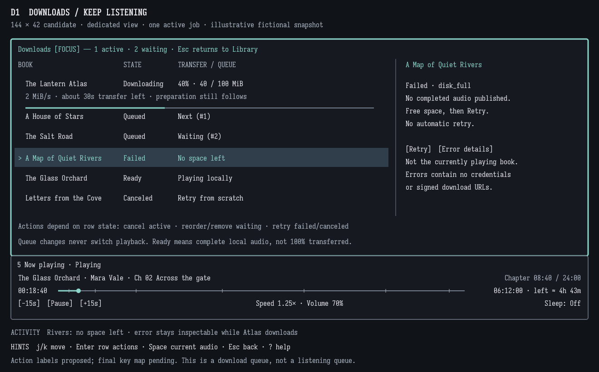
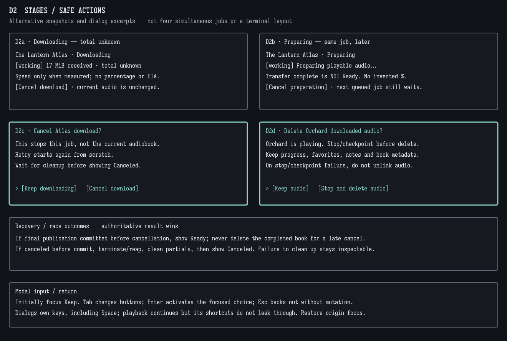

# Downloads design — D1 / D2

Status: **design direction accepted via merged PR #44** under #2. Not an implemented
download manager or final key map; compact/minimum dialog geometry remains to review.
This slice does not close #2 or unblock UI code. Implementation owners: job coordinator #16 and download UI #17,
following the engine download/protocol work. Fictional data only.

## D1 — Dedicated Downloads view while listening

[Editable D1 SVG](d1-downloads.svg)

Reuse the approved 144 × 42 candidate canvas and exact full-width player from W1.
Downloads temporarily replaces the content area, not the current audio session.
Return restores the originating Library view, highlighted BookID and focus. Compact
mode uses the same list/actions above its persistent player, condensing metadata
rather than hiding state or actionable errors; exact compact/minimum frames follow.

The list combines the active job, ordered waiting jobs and terminal records. Queue
position applies only to waiting jobs, not completed/failed/canceled records. There
is **one active job**, including licensing, transfer, preparation and publication;
starting another transfer during preparation would violate that model.

| State | Visible evidence | Proposed contextual actions |
|---|---|---|
| Queued | Waiting position and, when relevant, account/offline wait reason | Move up/down among waiting jobs; remove from queue |
| Downloading | Measured bytes, total/percentage only when known, measured speed | Cancel download; inspect details |
| Preparing | Explicit preparation label; indeterminate if no verified stage progress | Cancel preparation; inspect details |
| Ready | Complete published local file, not merely a completed transfer | Show in Library; delete downloaded audio with confirmation |
| Failed | Sanitized reason and recovery guidance, still inspectable | Retry explicitly; inspect error |
| Canceled | Canceled after worker cleanup; no complete file from this attempt | Retry from scratch |

D1 is a different illustrative fixture snapshot from W1, not a chronology claiming
Rivers lost an existing file. Its prior failure stays inspectable while Atlas runs.
The highlighted job's details do not replace Now Playing. Row activation opens
state-appropriate actions; it does **not** start audio or silently retry/delete.
Long metadata truncates/pans in available cells; unknown values use a labeled dash,
not a fabricated zero. Visible text states are required even with glyphs disabled.

## D2 — Alternative stages / confirmation excerpts

[Editable D2 SVG](d2-download-states.svg)

These are **alternative snapshots/dialog excerpts**, not concurrent jobs, a new
four-pane terminal composition or four dialogs shown together. Actual dialogs are
centered over their parent view; Now Playing stays visible where geometry permits,
and no modal pauses audio just by opening. Dimensions/compact overlays still need
review in the minimum-size slice. Use the same [typography](typography.md) and
[theme semantics](theming.md) as W1/C1.

### Truthful stage progress

- D1's known transfer: 40 / 100 MiB = 40%; measured 2 MiB/s gives about 30 seconds
  of **transfer** remaining. Preparation time is excluded; no end-to-end ETA claim.
- D2a: received bytes with unknown total; show a working indicator, **no percentage
  or ETA**. Report speed only when available, not a made-up steady rate.
- D2b: transfer is over; Preparing is not Ready. Do not retain a misleading 100%
  download bar as overall job progress. Verified ffmpeg progress may be shown only
  when its stage/denominator is understood; otherwise keep preparation indeterminate.
- Licensing/account wait and final publication use readable subordinate stage text;
  do not add fake byte samples. Only successful complete publication permits Ready.

### Cancel / publication race

D2c names the book and the stage; initially focus **Keep downloading** (or Keep
preparing). Confirming requests cancellation; keep the authoritative stage with a
"Canceling…" annotation until termination/reaping/cleanup resolves. Do not claim
Canceled merely because a button was pressed or because UI context was canceled.
Do not release the single-worker slot while its child is still running.

The [engine contract](../adr/001-engine-api-and-bridge-contract.md) decides the race:
if publication already committed, completion wins and the UI shows Ready. A late
cancel must not unlink that completed book. Otherwise finish cleanup and report
Canceled. Cleanup failures remain inspectable; never present partial files as Ready.
Retry does not promise byte-range resumption: canceled transfers start from scratch.

### Remove waiting job versus delete completed audio

Removing a waiting job only removes its queue entry. It does not delete audio,
favorites, bookmarks or history and does not cancel a different active job. Reorder
only waiting jobs, preserving stable job identity through background updates.

D2d is a **separate destructive action**, explicitly named Delete downloaded audio.
Initially focus **Keep audio**. For the loaded book (playing or paused), label the
confirming button **Stop and delete audio**: checkpoint and stop before unlinking.
If checkpoint/stop fails, do not delete. If deletion fails after stopping, retain the
file's truthful status and show recovery; do not imply playback is still running.
Non-current books do not stop current audio. Delete only Taletty-owned completed
media under its private downloads root; no arbitrary-path or old-app deletion.
Keep book metadata, progress, speed, favorites and bookmarks. Redownload is separate.

### Failure, offline and restart

- Persistence failure rejects a queue mutation visibly; do not pretend a reorder,
  removal or enqueue was saved. Keep the authoritative order and stable cursor.
- Network/disk/license/preparation failures remain inspectable. Retry is explicit;
  never automatically loop on entitlement/throttling errors or steal editor focus.
- Offline: cached jobs/library and completed local playback remain available.
  New network work waits with an explanation or returns a recoverable error; do
  not manufacture active transfer progress. Restored waiting order remains intact.
- Restart: restore waiting jobs; reconcile interrupted active jobs with a completed
  published file before offering retry. If no completed file exists, explain that
  the prior attempt was interrupted and needs retry. Do not invent a Ready result
  or imply a paused byte-range transfer can resume. Exact durable reconciliation
  belongs to #16 and its service tests, not rendering.

### Keyboard / focus proposal

Use j/k or arrows to move; Enter opens row actions; Esc closes actions and then
returns to the origin (after canceling/clearing an active local filter per the shared
contract). On the read-only Downloads list, Space/comma/period retain current-audio
transport. Action menus and confirmations own input: no leaked transport, quit,
favorite or pane shortcuts. Tab selects buttons; Enter activates the focused button;
Esc cancels without mutation. Initially focus the non-destructive choice. Keep action
menus' target job fixed even when progress or selection changes behind them; if it
finishes, invalidate stale actions rather than cancel/delete a different job.
Final download/reorder/retry/delete shortcuts remain unassigned until full key-map
review. Error details retain selection/focus on return and expose sanitized text,
never credentials, signed URLs or raw provider tracebacks.

## Implementation test handoff — no executable journeys claimed

| Journey | Required assertions |
|---|---|
| J04 | One worker through preparation/publication; dedup; known/unknown totals; no fake Ready |
| J05 | Cancel-before/after-commit race; process reaping; queue remove/reorder persistence failure; restart reconciliation; stale action target |
| J06 | Disk full/network/license/conversion failure; sticky inspectable error; explicit retry; sanitized diagnostics |
| J12/J17 | Confirm/cancel audio deletion; current paused/playing safety; stop/checkpoint/unlink failures; metadata/favorites retained |
| J13 | Resize list/dialog/error details; terminal-cell bounds; keys owned by modal; origin focus restored |

Design verification: parse SVGs, inspect Iosevka Slab PNG renders, validate links,
known-transfer math and reused player geometry. Runtime coverage **N/A**. Actual
UI→job service→store journeys and independent ≥95% production coverage ship with
#16/#17; screenshots do not substitute for them.
