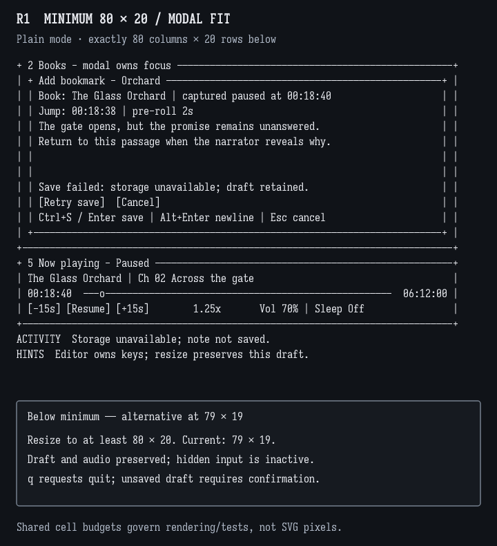
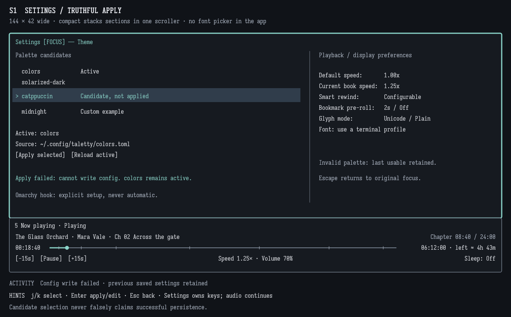
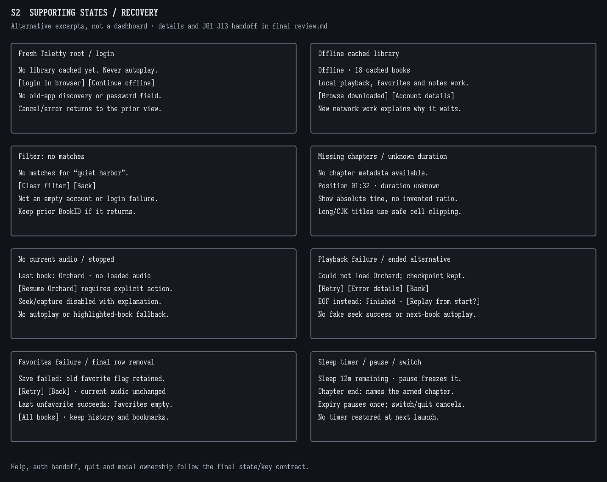

# Final design sign-off — #2

**Review status: accepted via merged PR #46; #2 is closed.** These are the approved
layout/interaction rules, not an additional planning gate. No runtime UI is
implemented by this document. Subsequent PRs deliver code/tests and accompanying
doc updates, not additional planning-only design PRs. Corrections found in real
terminal tests remain reviewable implementation changes, not permission to ignore
this contract. Illustrations use fictional data and semantic-theme stand-ins.

## Responsive composition: R1

[Editable R1](r1-responsive.svg). Earlier [W1/C1](README.md) remain the wide/compact
reference. **Approved fixed layout rules:**

| Mode | Terminal cells | Budget including borders/padding |
|---|---|---|
| Wide | width ≥144 **and** height ≥42 | Sidebar 24, Chapters 42, middle = width−66; content height = height−8; player 6 + activity 1 + hints 1 |
| Compact | width ≥80 and height ≥20, otherwise not Wide | One active pane, content height = height−7; player 5 + activity 1 + hints 1 |
| Below minimum | either width <80 or height <20 | Resize message, current dimensions, q quit; preserve underlying state, audio and draft |

Wide middle: Books gets floor(2×content-height/3), Details gets the remainder.
Thus 144×42 gives 24/78/42 columns and 22/12 middle rows. Regions own their border
cells; never add borders outside assigned budgets. Extra width grows the middle;
extra height grows content before decoration. No pixel measurement decides geometry.

Compact 80×20 gives 13 content rows and a 5-row player; 80×28 gives 21/5. Tab/numbers
expose one pane at a time, including Library destinations. Content titles retain
view/filter/book context. Player rows: top border/status, identity/chapter, full-width
book slider/timestamps, controls/speed/volume/sleep, bottom border. Hide author,
secondary chapter timing/remaining time before core identity, controls or errors.
Unknown duration uses known playback position plus an indeterminate labeled track; never
invent a filled percentage. Long titles ellipsize; horizontal pan reveals metadata.

Dialogs center **inside the content region**, with ≥2-column side and 1-row vertical
margins. Width ≤content-width−4, height ≤content-height−2. At minimum this is 76×11:
editor borders 2 + target/position 2 + note viewport 4 + error 1 + actions/hints 2.
Long notes scroll within that viewport; wrapped messages/buttons scroll/reflow within
the same budget. Modal owns Tab; background pane focus does not change. Download
menus/confirmations and B3 dialogs use this same bounded container, not fixed SVG
pixel dimensions. Settings/Help are dedicated scrollable content views.

On resize, preserve focused logical pane, BookID, row identity, offsets and modal
input. Below minimum temporarily hide the modal, do not cancel it; its dedicated
resize owner accepts resize and q/Ctrl+C quit requests, not hidden typing/transport.
An unsaved-draft quit request warns first: q again confirms, Esc keeps the draft;
clip that prompt safely at tiny sizes. On recovery restore the original modal. If a message cannot fit a tiny terminal, cell-clip
it safely, never emit overflow. Audio continues; the player-visibility guarantee is
for supported sizes only. Test 79/80/81 and 143/144/145 columns, 19/20/21 and 41/42/43
rows, including 144×20, 80×42 and zero-sized resize events.

## Settings: S1

[Editable S1](s1-settings.svg). Open with S; in compact mode stack the sections in
one scrolling view. Candidate selection is not an applied theme. Enter validates
and writes config; only successful write commits live palette and saved selection.
On failure retain prior active palette, candidate row, focus and readable diagnostic.
Keep `colors` first, then built-in `solarized-dark` / `catppuccin` and sorted valid
custom names; show active source, missing/invalid-file fallback and Reload action.
Reload failure retains last usable palette. All controls obey [theme rules](theming.md).
Omarchy hook is explicit opt-in setup with explanation, never implied by colors.
Iosevka Slab is terminal-profile guidance, **not** a fake font picker.

Playback settings expose default speed, smart rewind and bookmark pre-roll (including
off); numeric editors validate before writing and retain prior value on failure.
Per-book speed overrides default. Glyph mode offers Unicode/plain and optional Nerd
Font; unavailable icons never hide text state. Changing theme/glyph mode repaints
all views, keeps editor drafts and never disrupts audio. Config write/migration tests
belong with storage/theme implementation, not a special unmeasured config pathway.

## Supporting states: S2

[Editable S2](s2-supporting-states.svg). These are alternatives, not a new dashboard.

| State | Required composition / recovery |
|---|---|
| First launch / empty cache | Explain fresh Taletty root; Login / Continue offline. No autoplay or old-app discovery |
| Account handoff | Explicitly suspend/restore TUI around supported TTY browser login; no password/redirect URL/token in UI logs. Cancel returns to prior view; busy auth explains wait |
| Login/sync error | Sanitized readable reason, explicit Retry/Back, cached library retained; no automatic entitlement/throttle retry loop |
| Offline cache | Browse, filter, favorites/notes and complete local playback work; account status explains unavailable network work |
| Empty library / no filter matches | Distinguish no books from no matches; offer Sync/Login or Clear filter/Back respectively; retain prior selection by ID if it returns |
| No chapters / missing metadata | Honest unavailable label, absolute seek time still shown; unknown duration/total never implies zero or Ready |
| Player empty / stopped | No current audio; controls disabled with reason. Last-book label may remain for explicit named Resume action, never autoplay or b fallback |
| Player paused / ended | Paused shows Resume. Natural EOF marks Finished; no automatic next book. Replay offers explicit start-over confirmation; manual mark-unfinished keeps checkpoint |
| Player error | Retain book/checkpoint, truthful unloaded/error state, explicit Retry/Back; never claim transactional old-process rollback or successful seek |
| Favorites save error / last removal | Keep authoritative old favorite flag on failure. Success removing final visible row shows empty Favorites and All action; never switches/stops audio |
| Sleep timer | t offers 15/30/45/60 min, chapter end, Off. Show remaining/target in player; chapter-end unavailable without chapter metadata. Pause freezes duration; expiry pauses once. Switch/quit cancel; no restored timer on launch |
| Sleep chapter seek | Capture chapter-end target on arm; explicit seek into another chapter cancels it, avoiding an unexpected pause. Duration timer survives same-book seeks; time is real playing elapsed, not speed-scaled book time |
| Help / errors | ? shows context key map and disabled reasons; long error details scroll; sticky failure survives unrelated background success; closing restores origin |
| Quit | Checkpoint/stop player, cancel/reap active worker, retain waiting order. Unsaved draft or shutdown failure gets explicit keep/retry/quit warning, no silently discarded data |

Mark Finished/Unfinished, delete downloaded audio, error details and explicit Resume
are named x-menu actions, not extra ambiguous shortcuts. Manual completion changes
metadata, not current audio. For a finished book, Play offers Replay from start;
bookmark/chapter actions still target their explicit time. Account, settings, sort,
timer and confirmations own their keys; read-only transport exceptions are enumerated
in the [complete key map](keys.md). Cross-book chapters/bookmarks use the merged B3
Stay / Switch and play confirmation, and downloaded-ready never auto-jumps.

## Glyphs / spacing / typography

Use monospace cell geometry, one-cell list gutter and one-cell inner padding in
production. Keep visible focus border plus `[Focus]` label, `>` cursor and named
status even without color. SVG spacing is illustrative; terminal-cell budgets above
are authoritative. [Iosevka Slab](typography.md) remains optional and terminal-owned.

| Meaning | Unicode option | Required plain fallback |
|---|---|---|
| Favorite | ★ | [Fav] |
| Playing / paused / stopped | ▶ / Ⅱ / ■ | Playing / Paused / Stopped |
| Transfer / waiting / preparing | ↓ / … / … | Downloading / Queued / Preparing |
| Ready / failure / canceled | ✓ / ! / × | Ready / Failed / Canceled |
| Slider / chapter tick | ─ / ● / │ | - / o / \|, with elapsed/duration labels |
| Sleep | time label, optional icon | Sleep 12m / Sleep chapter 02 / Off |

Nerd glyphs are decorative opt-in only. Do not assume ambiguous glyph widths; replace
unsupported markers, and measure/clip terminal cells for CJK, combining characters
and emoji. Sanitize ANSI/control sequences in metadata, notes, diagnostics and
filenames; a font or SVG render cannot prove terminal safety.

## Acceptance handoff and bounded deferrals

| Journeys | Reviewed references → implementation assertions |
|---|---|
| J01/J02/J14 | S2 + F1 → fresh private root, login cancel/error, cached offline browse, resume not autoplay |
| J03/J17 | W1/C1 + S2 + keys → contributor filter, sort/refresh identity, typing ownership, favorites persistence/failure/final row |
| J04–J06 | D1/D2 → one worker through preparation, real progress, cancel/publication race, retry/restart/error recovery |
| J07/J08 | F1/B3 + keys → highlighted≠current, confirmed switch/checkpoint, paused seek, speed/volume/remaining math |
| J09 | B1–B3 + R1 → captured target/time, multiline/save failure, pre-roll once, edit/delete/jump/no audio, modal focus |
| J10/J11 | S2 → fake-clock timer/pause/switch/seek/quit, EOF vs manual completion/replay, no next-book autoplay |
| J12/J13 | D2 + R1/S1/S2 → safe audio deletion/metadata retention, all geometry boundaries, PTY keys/resize/quit, recovery focus |

J15 local import and J16 global bookmark search/export stay later #22/#23; no hidden
MVP shortcuts. Artwork is deliberately deferred: no guaranteed provider art, terminal
image protocol or first-release cover pane. First-release details use metadata/text,
so there is no placeholder media-integration promise. No real waveform/spectrum.
Manual/live-provider and generated-media release evidence remain required.

All runtime coverage here is **N/A**. Each feature delivers real model/service/store,
PTY and media tests as applicable with independent ≥95% coverage; design tables,
rendered previews and a passing docs CI are not user-journey implementation evidence.
Final approval applies to these decisions and existing W1/C1/F1/D1/D2/B1–B3 sources;
implementation refinements must preserve the behavior or get explicit PR review.
